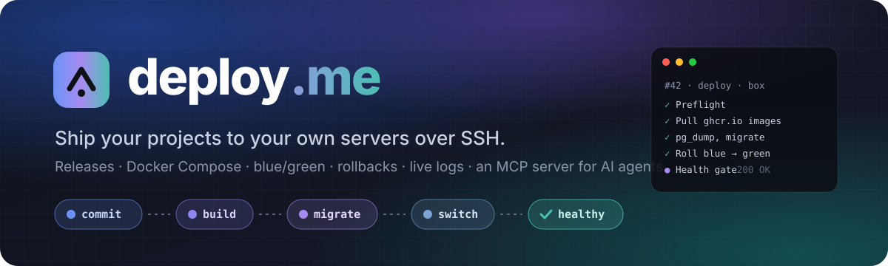
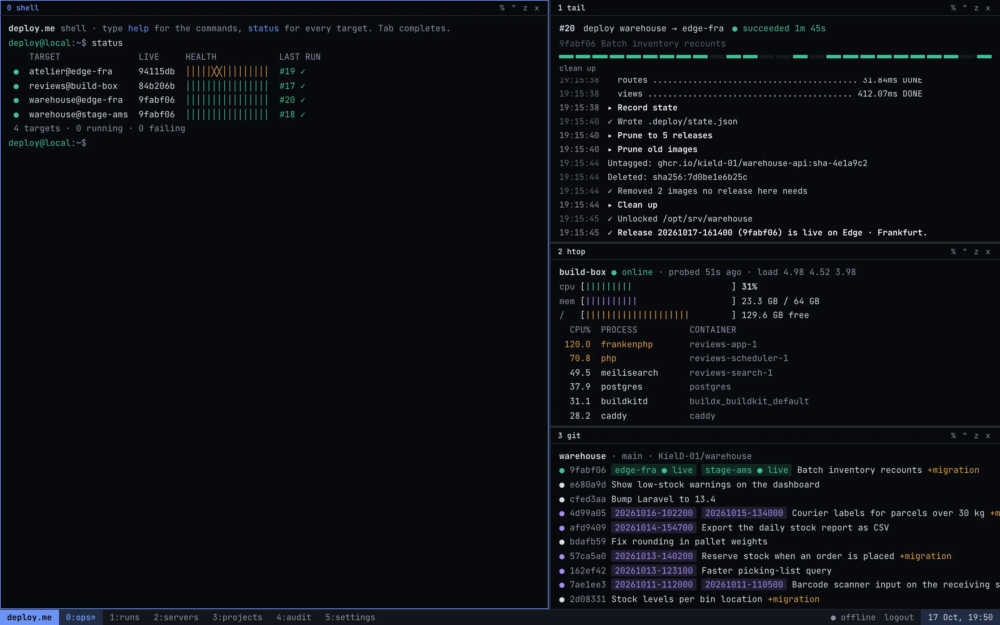
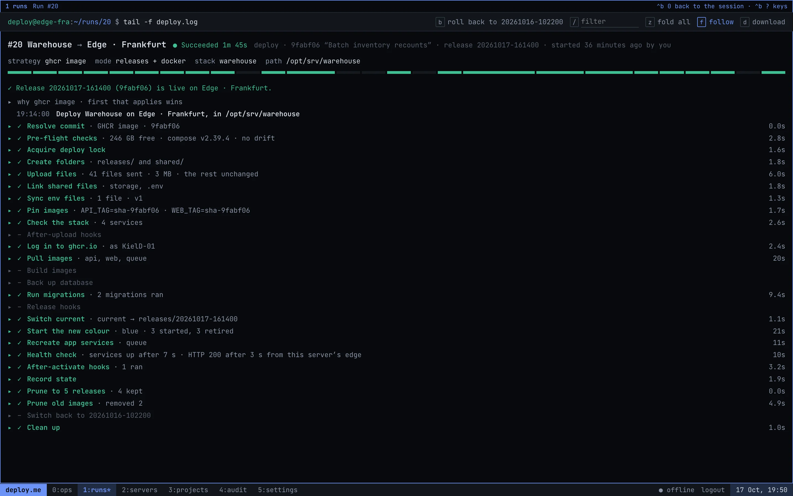
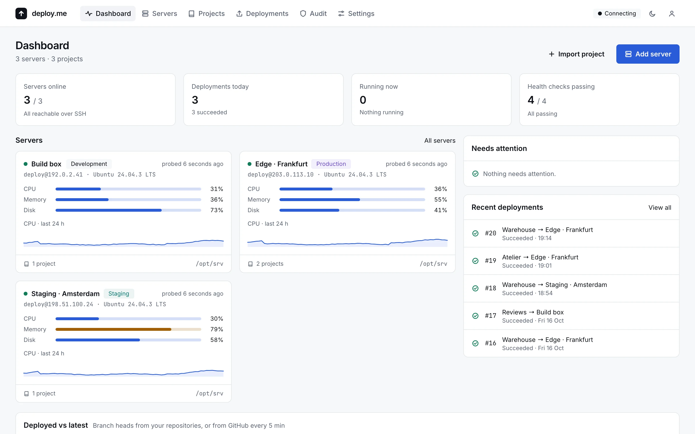
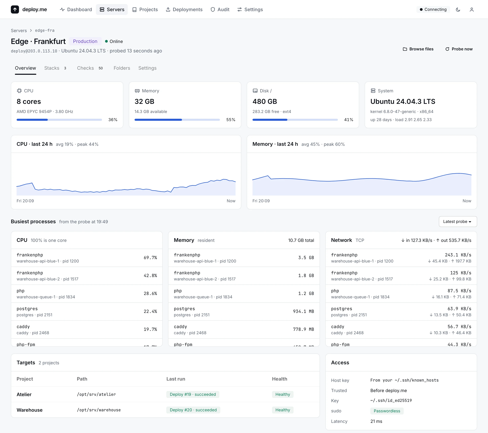
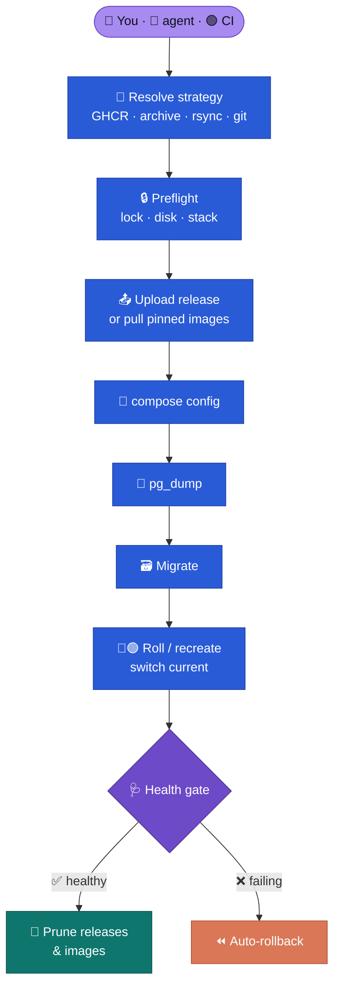

<p align="center">
  
</p>

<p align="center">
  <a href="https://laravel.com"></a>
  <a href="https://frankenphp.dev"></a>
  <a href="https://livewire.laravel.com"></a>
  <a href="https://tailwindcss.com"></a>
  <br>
  <a href="https://docs.docker.com/compose/"></a>
  <a href="https://www.postgresql.org"></a>
  <a href="docs/mcp.md"></a>
  <a href="#-tests"></a>
  <br>
  <a href="LICENSE"></a>
  <a href="#️-made-together-with-claude"></a>
</p>

<p align="center">
  <b>🇬🇧 English</b> · <a href="README.uk.md">🇺🇦 Українська</a>
  <br><br>
  <a href="#-quick-start">Quick start</a> ·
  <a href="docs/install.md">Install</a> ·
  <a href="docs/usage.md">User guide</a> ·
  <a href="docs/gallery.md">Gallery</a> ·
  <a href="docs/mcp.md">MCP for AI agents</a> ·
  <a href="#️-architecture">Architecture</a> ·
  <a href="#️-security-model">Security</a>
</p>

---

**deploy.me** is a local, Dockerized admin app that deploys your projects to **your own
servers over SSH**. You run it on your Mac at `https://deployme.localhost`.

- Servers come straight from your `~/.ssh/config`.
- Projects come from GitHub or from a local folder.
- Every run is recorded with a live, redacted log.
- It deploys with releases and an atomic switch, or in place.
- It builds or pulls images, migrates, starts the new containers beside the old ones, and
  rolls back by itself when the health check says no.

You don't need a PaaS, a cloud control plane or an agent on the server: just `ssh`,
`rsync` and `docker compose` on the other end.

> [!NOTE]
> deploy.me runs real production sites. Every feature below is built, tested, and in use.

## ✨ Features

<table>
<tr>
<td width="50%" valign="top">

### 🖥️ Servers
Added from `~/.ssh/config`. Host keys are trusted on first use and pinned after that.
Scheduled probes read CPU, load, memory, disks, Docker, Compose stacks and the edge proxy,
plus the **ten busiest processes** by CPU, memory and TCP traffic, each shown with its
container. Status updates live over websockets.

</td>
<td width="50%" valign="top">

### 📦 Projects
Imported from GitHub (read through the API, never cloned) or a local folder. deploy.me
detects workflows, GHCR image templates, Compose stacks, the framework and env templates.
**Env files are encrypted and versioned**, and it can push a local project to a new GitHub
repository.

</td>
</tr>
<tr>
<td valign="top">

### 🚀 Deploys
Two layouts: `releases/<timestamp>` with `shared/` and an atomic `current` link (keeping the
last *N*), or **in place**. Each run takes a remote lock, streams a redacted log, and can be
cancelled cleanly or **retried from the step that failed**.

</td>
<td valign="top">

### 🐳 Docker Compose
Before anything changes, `compose config` checks the stack. Then images are built on the
server or **pulled from ghcr.io and pinned** to the release, `pg_dump` runs before
migrations, and migrations run in a one-off container. A health gate checks the services,
an HTTP URL and your own command. Old images are pruned afterwards.

</td>
</tr>
<tr>
<td valign="top">

### 🔵🟢 Blue/green
Edge-facing services start **beside** the running ones, and the old ones are retired only
once the new colour is healthy. A deploy that fails there costs **zero downtime**.

</td>
<td valign="top">

### ⏪ Rollbacks
Switch back to any release that's still on disk. For in-place projects, the images an
earlier release pinned are put back. Rollback is **automatic** when a health check fails
after the switch.

</td>
</tr>
<tr>
<td valign="top">

### 🚚 Delivery strategies
An ordered list: **GHCR image** · **push archive** · **push rsync** · **server git**. The
first one that applies wins, and the trace explains why. A deploy can wait for CI, or
start on its own when CI goes green.

</td>
<td valign="top">

### 🧳 Adopt & convert
Take over a project that's already running in place: deploy.me records its commit, image
pins and stack as the live release. Or **convert** an old folder into `releases/` +
`shared/`, with a plan, a backup and undo.

</td>
</tr>
<tr>
<td valign="top">

### 🩺 Health, alerts & audit
Scheduled health checks keep a history. The dashboard compares each target's live commit
with its branch. **Telegram alerts** cover failed runs and health changes. An
**append-only audit log** records every remote command.

</td>
<td valign="top">

### 🤖 MCP for AI agents
`php artisan deployme:mcp` gives Claude, Cursor or VS Code **13 tools**: look around,
explain a failed run, plan a deploy. With `--allow-deploys` the agent can also deploy,
roll back and cancel, and the client asks you before each one.
[→ docs/mcp.md](docs/mcp.md)

</td>
</tr>
</table>

Also included: 🔁 one-way **folder mappings** (Mac ↔ server, rsync, previews, capped
deletes), 🔑 **passkey or password sign-in** (with optional authenticator codes), and 💾 nightly **backups** of deploy.me itself.

## 📸 Screenshots

Two themes over the same app: **Console** (deploy.me as a tmux session) and **Classic**. More in
the **[gallery](docs/gallery.md)**: deploying from the shell, an automatic rollback, the deploy
dialog, env files, folder sync, the audit log…

<table>
<tr>
<td width="50%"><a href="docs/gallery.md"></a></td>
<td width="50%"><a href="docs/gallery.md"></a></td>
</tr>
<tr>
<td width="50%"><a href="docs/gallery.md"></a></td>
<td width="50%"><a href="docs/gallery.md"></a></td>
</tr>
</table>

## 🚀 Quick start

All you need is Docker. deploy.me runs the same way on all three systems and brings its own
PostgreSQL, Valkey and HTTPS edge, unless you already run a shared stack it can join.

#### 🍎 macOS · 🐧 Linux

You need Docker Desktop or OrbStack on macOS, or Docker Engine with the Compose plugin on
Linux. Then run this one line:

```bash
curl -fsSL https://raw.githubusercontent.com/KielD-01/deploy.me/main/install.sh | bash
```

It clones deploy.me into `~/deploy.me` and runs `bin/install`. Read
[`install.sh`](install.sh) first if you like. To do the same by hand:

```bash
git clone https://github.com/KielD-01/deploy.me.git
cd deploy.me
bin/install
```

#### 🪟 Windows

You need WSL2 and Docker Desktop with WSL integration turned on. Then, in PowerShell:

```powershell
irm https://raw.githubusercontent.com/KielD-01/deploy.me/main/bin/install.ps1 | iex
```

`bin/install` does everything in one go:

- checks the tools it needs;
- describes your machine in `.env` (`bin/configure`);
- pulls the ready-made PHP image from Docker Hub (amd64 and arm64), so nothing compiles,
  and starts the stack;
- trusts the local CA in your browsers (macOS keychain, Linux NSS, Windows' store);
- prints a one-time link that sets up your **passkey** or a password.

The per-OS notes, the two stack modes and troubleshooting are in
**[docs/install.md](docs/install.md)**.

Open **https://deployme.localhost**, then:

1. **Servers → Add server.** Pick a host from `~/.ssh/config`, trust its key, choose a
   deploy path.
2. **Projects → Import project.** Pick a GitHub repository or a local folder.
3. **Targets → Assign to server**, then **Prepare**.
4. **Deploy** 🎉

> [!WARNING]
> Back up `APP_KEY` from `src/api/.env`. Stored tokens and env files are encrypted with it.

Want a safe playground first? `make sandbox` starts a local SSH + Docker server with the
alias `sandbox`.

## 🤖 Talk to it

```bash
# Read-only: look, explain, plan, probe
claude mcp add deployme -- docker exec -i deployme-web php artisan deployme:mcp

# …or allow deploys, rollbacks and cancels too
claude mcp add deployme-ops -- docker exec -i deployme-web php artisan deployme:mcp --allow-deploys
```

> 💬 *"What's deployed where, and is anything unhealthy?"*
>
> 💬 *"Why did run #42 fail? Show me the step that broke."*
>
> 💬 *"Is there a green build on main that isn't live yet? Deploy it to staging and watch it."*

Setup for Claude Desktop, Cursor and VS Code, the full tool list and the safety model are in
**[docs/mcp.md](docs/mcp.md)**.

## 🗺️ How a deploy flows



## 🏗️ Architecture

```mermaid
flowchart LR
    subgraph mac["💻 Your Mac"]
        browser["🌐 Browser<br/>deployme.localhost"]
        agent["🤖 MCP client"]
        subgraph app["deploy.me containers"]
            web["deployme-web<br/>FrankenPHP · Livewire"]
            worker["deployme-worker<br/>queues · scheduler"]
            reverb["deployme-reverb<br/>websockets"]
        end
        subgraph infra["shared infra · proxy-network"]
            caddy["Caddy edge"]
            pg[("PostgreSQL")]
            valkey[("Valkey")]
        end
    end
    servers[("🖥️ Your servers")]
    github["🐙 GitHub · GHCR"]

    browser --> caddy --> web
    caddy --> reverb
    agent -- "stdio · docker exec" --> web
    web --> pg
    web --> valkey
    worker --> pg
    worker --> valkey
    worker -- "ssh · rsync" --> servers
    worker -- "API" --> github

    classDef c fill:#2a5bd7,stroke:#1f45a8,color:#fff
    classDef i fill:#0f766e,stroke:#0b5750,color:#fff
    classDef x fill:#6d4ac7,stroke:#4c3291,color:#fff
    class web,worker,reverb c
    class caddy,pg,valkey i
    class servers,github,agent,browser x
```



| Service | Role |
|---|---|
| `deployme-web` | FrankenPHP serving the app. The shared edge routes `deployme.localhost` to it, and websocket requests on `/app` to Reverb |
| `deployme-worker` | Supervisor: the queue workers (`redis`, `redis-deploys`, `redis-probes`) and the scheduler. The only container that mounts project folders read-write |
| `deployme-reverb` | Reverb websockets: live logs, server status, CI updates |
| `deployme-vite` | Vite dev server with HMR (`dev` profile only) |
| `deployme-sshd-target` | A local sshd + Docker sandbox server (`sandbox` profile only) |

<details>
<summary><b>🗂️ Code map</b></summary>

| Path | What lives there |
|---|---|
| `src/api/app/Platform/Ssh` | Every SSH call: system `ssh -F` with a compiled config, scripts sent over stdin |
| `src/api/app/Platform/Remote` | Server probes and snapshots |
| `src/api/app/Platform/{Detection,Git,GitHub,Local}` | Project import and detection |
| `src/api/app/Deploy` | Pipeline runner, steps, remote locks, step logger; `Delivery/` strategies; `Conversion/` |
| `src/api/app/Mcp` | The MCP server and its tools |
| `src/api/app/Actions` | Health checks, folder syncs, CI polling, maintenance |
| `src/api/app/Livewire` | The pages |
| `src/api/resources/ssh-scripts` | The bash scripts that run on your servers |
| `core/local` | The PHP image, supervisor programs, the sandbox server |
| `bin` | Host-side scripts: `db-create.sh`, `doctor.sh`, `backup.sh` |
| `design/canvas` | The design the UI is built to match |

[`CLAUDE.md`](CLAUDE.md) is the detailed map for anyone changing the code.

</details>

## 🧰 Everyday commands

| Command | What it does |
|---|---|
| `make up` · `make down` · `make restart` | Start, stop or restart the stack |
| `make ps` · `make logs s=deployme-worker` | Status; follow logs (`s=` for one service) |
| `make enroll` | A one-time link to set up a passkey or password (first run, or a lost way in) |
| `make doctor` | Check infra, containers, TLS, websockets, every server alias and the GitHub tokens |
| `make dev` · `make assets` | Vite with HMR · build the frontend |
| `make test` · `make sandbox` · `make test-ssh` | The Pest suite · start the SSH sandbox · run the real-SSH tests against it |
| `make backup` · `make backup-install` · `make backup-status` | Back up deploy.me's database and `APP_KEY` |
| `make artisan c="…"` · `make sh` | Artisan, or a shell, in the web container |
| `make help` | Every target |

## 🛡️ Security model

- 🔑 **Passkeys first, a password if you need one.** The password needs at least 12
  characters, is rate-limited, and can require an authenticator code. There's one account:
  the first visit (or `make enroll`) creates it, then the page is gone, and the last way in
  can't be removed. Trusting
  a host key, touching env files, deleting during a sync, adding or removing tokens, and
  changing how you sign in all ask you to confirm it's you again.
- 🤫 **Secrets never go in argv or logs.** Remote scripts receive them over stdin, git gets
  tokens only through `GIT_ASKPASS`, and the step logger redacts before anything is stored
  or broadcast.
- 🔐 **Encrypted at rest.** GitHub tokens, env files and the Telegram token are encrypted
  with `APP_KEY`.
- 📌 **Pinned host keys.** Trusted on first use and stored in the database. A changed key
  stops the connection.
- 👀 **The probe reads names and counters, never command lines.** Its network sample runs
  read-only `ss` under `sudo -n`, and is skipped where sudo would ask for a password.
- 🚧 **Guard rails.** Local imports stay inside the project roots, nothing is pushed into a
  reserved server path (`/opt/infra`), and the MCP server is read-only unless you say
  otherwise.

## 🧪 Tests

```bash
make test       # 590+ Pest tests, in the container, against deployme_test
make sandbox    # then:
make test-ssh   # the deploy scripts for real, against the local SSH sandbox
```

`tests/Feature/Deploy/PipelineMatrixTest.php` guards which steps run for each deploy mode ×
delivery strategy. `tests/Feature/QueueConfigTest.php` keeps every queue's `retry_after`
above its worker timeout.

## ❤️ Made together with Claude

deploy.me was designed and built by **[Roman Kozin](https://github.com/KielD-01)** together
with **[Claude](https://claude.ai)**, Anthropic's AI, working as a pair in
[Claude Code](https://claude.com/claude-code). They worked through the plan, the design
canvas, the deploy engine and its bash scripts, the tests, the MCP server and this README,
one commit at a time. Roman made the calls and Claude wrote most of the code with him. 🤝

## 📄 License

[MIT](LICENSE) © 2026 Roman Kozin. Use it, fork it, ship with it.

<p align="center"><sub>Built in Ukraine 🇺🇦 with ☕, 🐳 and a lot of <code>ssh</code>.</sub></p>
