# 📸 Gallery

deploy.me has two themes, switched in **Settings → Appearance**. The **Console** theme (the default) shows the
app as a tmux session. **Classic** has a top bar, cards and tables. Both do the same work on
the same data. Click a picture to see it full size.

> [!NOTE]
> These are screenshots of a demo: three example servers (documentation IP ranges), three
> projects with git histories of their own, and a week of runs. It was all made by deploy.me's own
> code, with a stand-in for ssh: `php artisan db:seed --class=DemoSeeder` on an empty database.

## Console

<table>
<tr>
<td width="50%" valign="top">

<b>The session.</b> A shell (here <code>status</code>, every target at a glance), the latest run's
<code>tail -f</code>, <code>htop</code> for a server and <code>git log</code> for a project. Split, zoom and move
between panes with tmux's keys.
</td>
<td width="50%" valign="top">
<a href="assets/gallery/console-deploy-plan.webp">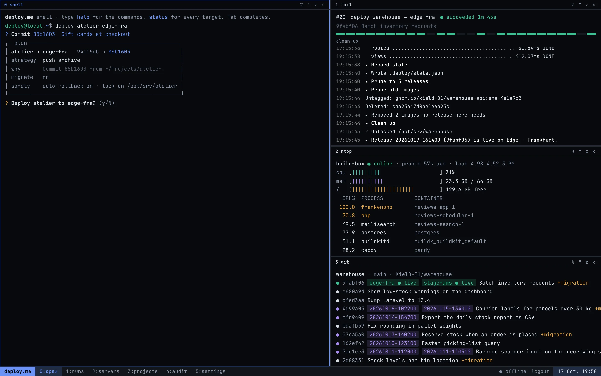</a>
<b>Deploy from the shell.</b> <code>deploy atelier edge-fra</code> asks for the commit and shows the
plan: what changes, the strategy and why, migrations, safety. Then it asks before it starts.
</td>
</tr>
<tr>
<td valign="top">

<b>A run, step by step.</b> GHCR images pinned to the commit, migrations, the new colour started
beside the old one, the health gate, pruning. Each step folds open to its log.
</td>
<td valign="top">
<a href="assets/gallery/console-rolled-back.webp">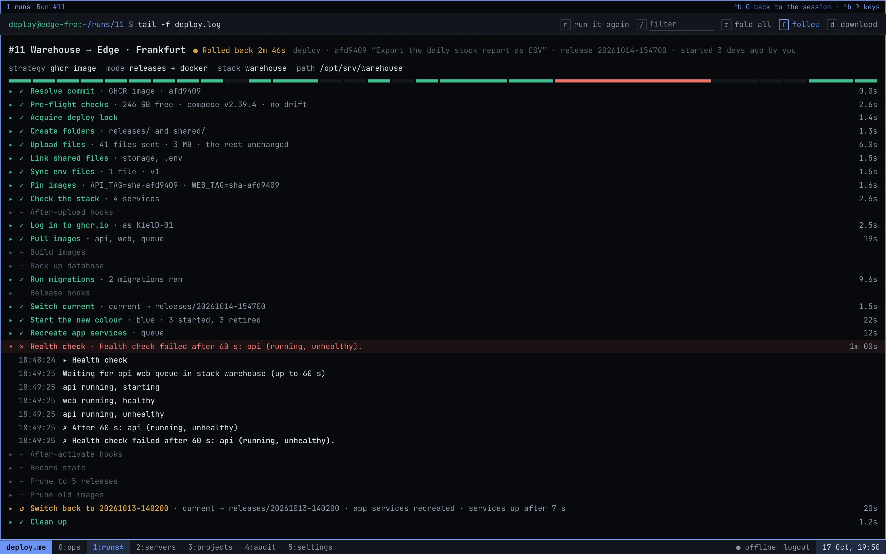</a>
<b>When the health check says no.</b> The new release went live, its API never turned healthy,
and deploy.me switched back to the previous release by itself.
</td>
</tr>
<tr>
<td valign="top">
<a href="assets/gallery/console-server.webp">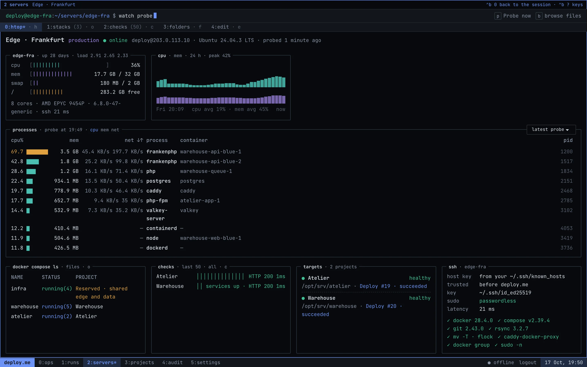</a>
<b>A server.</b> Meters, the last day's CPU and memory, the busiest processes by CPU, memory and
TCP traffic (each with its container), Compose stacks, health checks and the ssh setup.
</td>
<td valign="top">
<a href="assets/gallery/console-project.webp">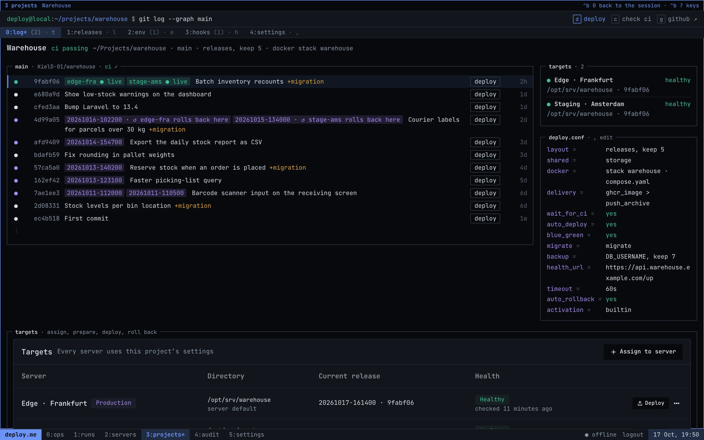</a>
<b>A project.</b> The branch as <code>git log --graph</code>: where each commit is live, which
releases a rollback can go back to, migrations, and a deploy button on every commit.
</td>
</tr>
</table>

## Classic

<table>
<tr>
<td width="50%" valign="top">

<b>Dashboard.</b> Servers and their load, today's runs, health, and what needs attention.
</td>
<td width="50%" valign="top">
<a href="assets/gallery/classic-servers.webp">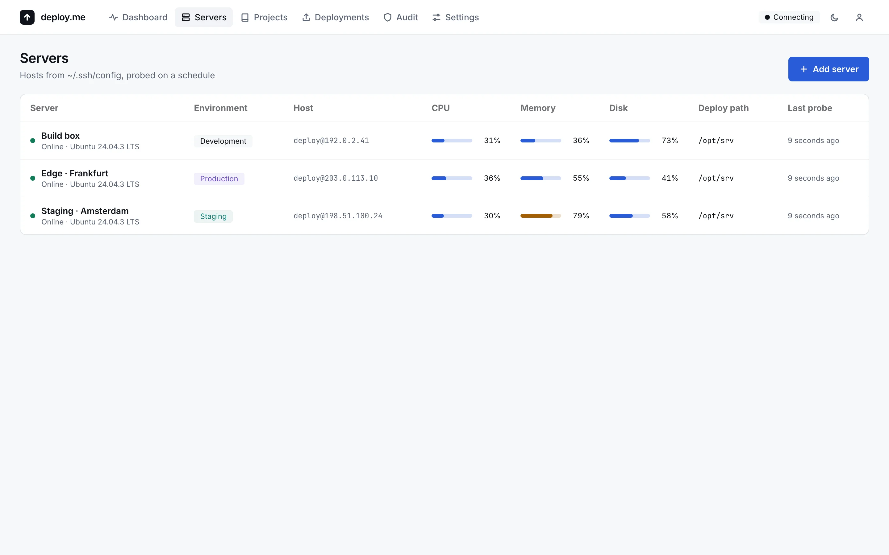</a>
<b>Servers.</b> Straight from <code>~/.ssh/config</code>, probed on a schedule.
</td>
</tr>
<tr>
<td valign="top">

<b>A server's overview.</b> Resources, the last 24 hours, and the busiest processes from any probe
of the last day.
</td>
<td valign="top">
<a href="assets/gallery/classic-projects.webp">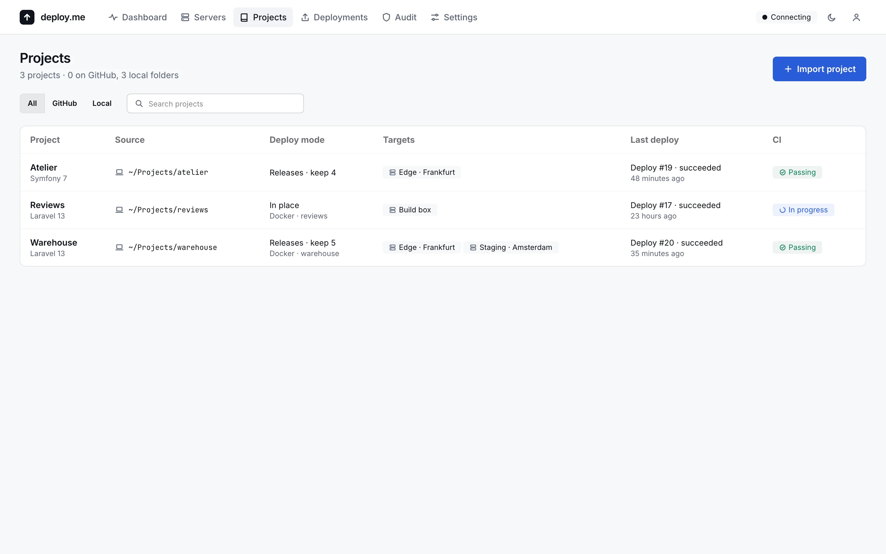</a>
<b>Projects.</b> From GitHub or a local folder, with how each one deploys, where, and its CI.
</td>
</tr>
<tr>
<td valign="top">
<a href="assets/gallery/classic-project.webp">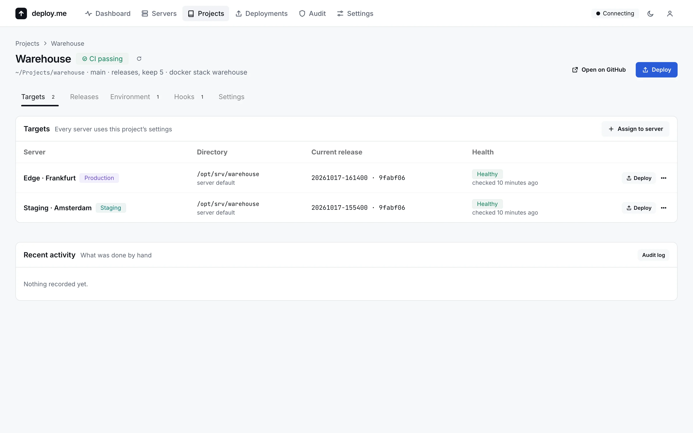</a>
<b>A project's targets.</b> Every server it deploys to, its live release and its health.
</td>
<td valign="top">
<a href="assets/gallery/classic-deploy-dialog.webp">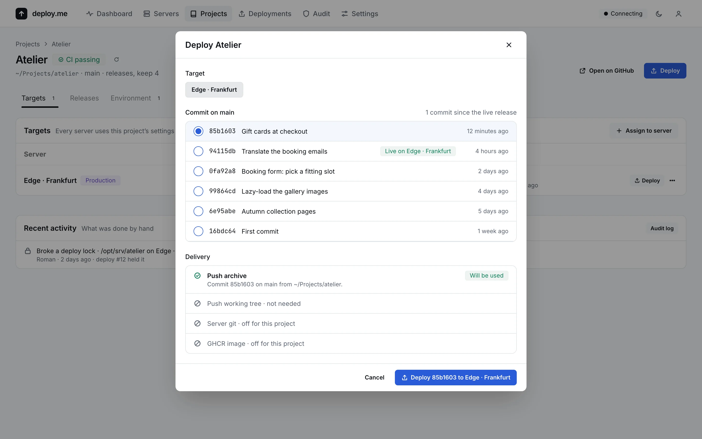</a>
<b>The deploy dialog.</b> Pick a commit, and see which delivery strategy will ship it and why the
others won't.
</td>
</tr>
<tr>
<td valign="top">
<a href="assets/gallery/classic-run.webp">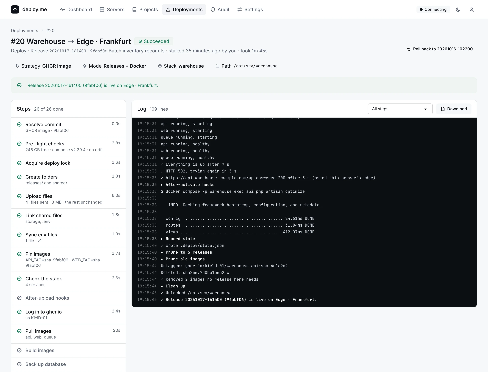</a>
<b>A run.</b> Steps on the left, the live log on the right, with secrets masked.
</td>
<td valign="top">
<a href="assets/gallery/classic-runs.webp">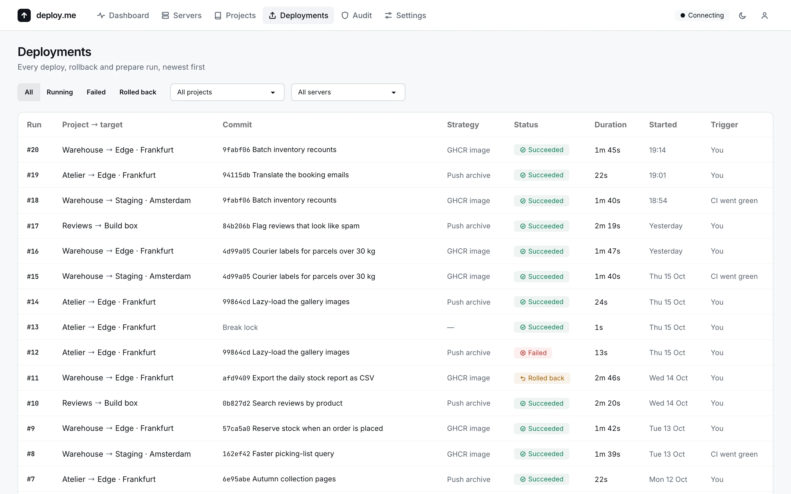</a>
<b>Every run.</b> Deploys, rollbacks and prepares, by hand or started when CI went green.
</td>
</tr>
<tr>
<td valign="top">
<a href="assets/gallery/classic-env.webp">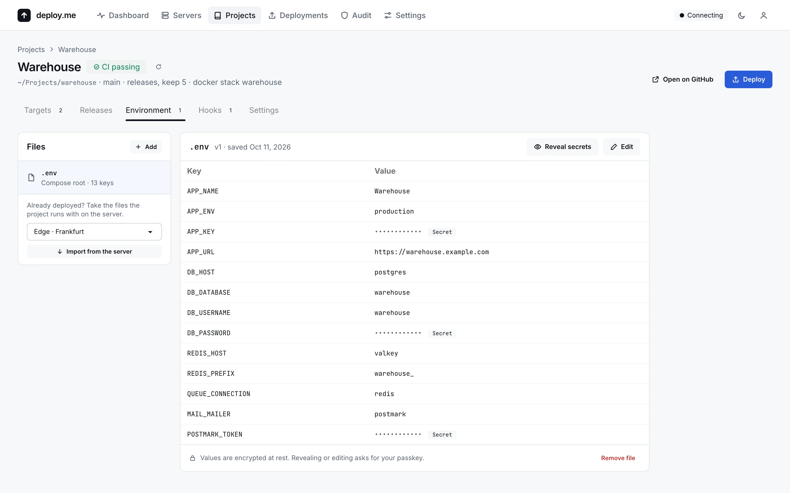</a>
<b>Env files.</b> Encrypted and versioned. Secrets stay masked until you confirm with a passkey.
</td>
<td valign="top">
<a href="assets/gallery/classic-folders.webp">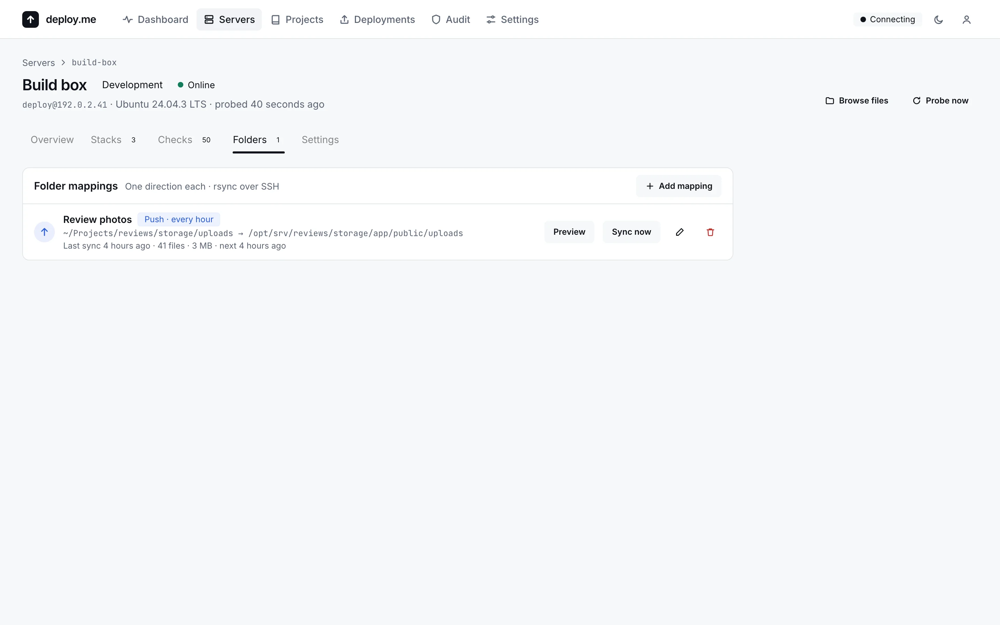</a>
<b>Folder sync.</b> A folder on the Mac and one on a server, one way, on a schedule, with previews.
</td>
</tr>
<tr>
<td valign="top">
<a href="assets/gallery/classic-audit.webp">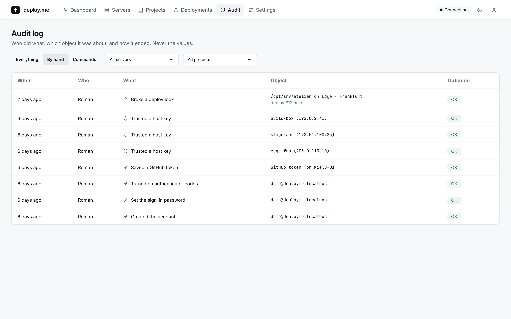</a>
<b>Audit log.</b> Who did what, and how it ended, but never a value. Nothing in it can be edited.
</td>
<td valign="top">
<a href="assets/gallery/classic-appearance.webp">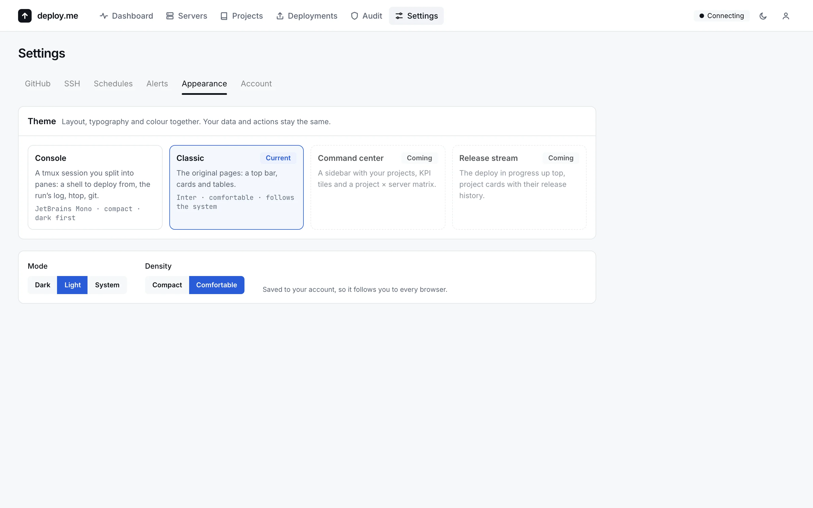</a>
<b>Appearance.</b> Pick a theme, dark or light, and the density. The choice follows you to
every browser.
</td>
</tr>
</table>
