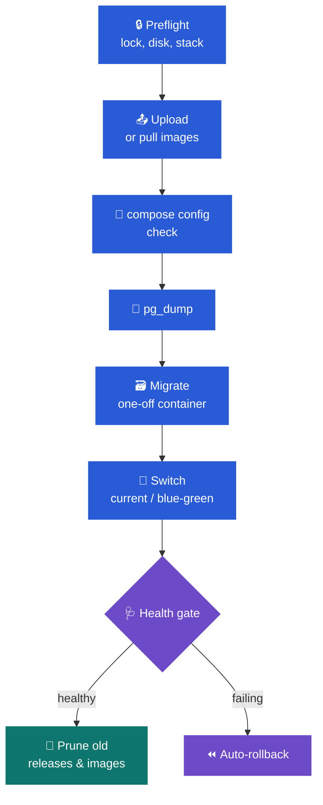

# 📘 deploy.me user guide

This guide walks through installing deploy.me, adding a server, importing a project, and
running it in production: deploys, rollbacks, blue/green, alerts and backups. Each
chapter stands on its own, so skip to the one you need.

- [1. Install](#1--install)
- [2. Sign in with a passkey](#2--sign-in-with-a-passkey)
- [3. Add a server](#3--add-a-server)
- [4. Import a project](#4--import-a-project)
- [5. Tune the project's settings](#5--tune-the-projects-settings)
- [6. Assign it to a server and prepare the folder](#6--assign-it-to-a-server-and-prepare-the-folder)
- [7. Deploy](#7--deploy)
- [8. Roll back, redeploy, retry, cancel](#8--roll-back-redeploy-retry-cancel)
- [9. Env files](#9--env-files)
- [10. Projects that were already running](#10--projects-that-were-already-running)
- [11. Deploy on green CI](#11--deploy-on-green-ci)
- [12. Health checks, dashboard and alerts](#12--health-checks-dashboard-and-alerts)
- [13. Folder mappings](#13--folder-mappings)
- [14. Audit log](#14--audit-log)
- [15. Back up deploy.me itself](#15--back-up-deployme-itself)
- [16. Let an AI agent help](#16--let-an-ai-agent-help)
- [17. Troubleshooting](#17--troubleshooting)

---

## 1. 🧱 Install

You need **Docker** and your servers in **`~/.ssh/config`**. deploy.me runs the same way on
macOS, Linux and Windows (inside WSL2), and brings its own PostgreSQL, Valkey and HTTPS
edge, unless you already run a shared stack it can join.

```bash
git clone https://github.com/KielD-01/deploy.me.git
cd deploy.me
bin/install
```

On Windows, run this in PowerShell instead:
`irm https://raw.githubusercontent.com/KielD-01/deploy.me/main/bin/install.ps1 | iex`.

`bin/install` works through these steps:

1. It checks the tools it needs.
2. `bin/configure` writes `.env` and `compose.host.yml` for this machine: the stack mode,
   the user the containers run as, your timezone, your project roots and your ssh-agent.
3. `bin/db-create.sh` creates `src/api/.env` and the `deployme` role and databases.
4. It builds the image, starts the stack and builds the assets.
5. `deployme:setup` generates `APP_KEY` and the Reverb credentials, and migrates.
6. `bin/trust-ca` trusts the edge's local CA in your browsers.
7. `make doctor` checks everything.
8. It prints your passkey link.

Each OS has its own notes: Linux UIDs, WSL and your Windows `.ssh`, Firefox. Those, and the
two stack modes, are in **[install.md](install.md)**.

> [!WARNING]
> **Back up `APP_KEY`** from `src/api/.env` and keep it in a password manager. GitHub tokens
> and env files are encrypted with it, and they can't be read without it.

## 2. 🔑 Sign in with a passkey

deploy.me signs you in with a passkey only. There are no passwords.

```bash
make enroll
```

This prints a one-time link that works for 15 minutes. Open it, register a passkey
(Touch ID, iCloud Keychain, 1Password, a hardware key…), and you're in at
**https://deployme.localhost**. Run `make enroll` again whenever you add a device or lose
a passkey.

Sensitive actions ask for the passkey again. These include trusting a host key, revealing
or editing env files, deleting files during a sync, and removing a GitHub token.

## 3. 💻 Add a server

**Servers → Add server** walks you through four steps:

1. **Pick a host.** The list comes from your `~/.ssh/config`. deploy.me shows what `ssh -G`
   resolves for the host (HostName, User, IdentityFile, ProxyJump), so you can see exactly
   where it will connect.
2. **Connection check.** It connects and shows the server's host key fingerprint. Compare
   it with the one on the server, then click **Trust and continue**. The key is pinned from
   then on, and a changed key stops every connection.
3. **Default deploy path.** Choose where projects go, for example `/opt`. You'll see the
   filesystem and free space. A project lands in `{path}/{project-slug}`.
4. **Name and environment.** Name the server, tag it (production, staging, development),
   and review what deploy.me found: Docker, Compose, git, rsync, the edge proxy, passwordless
   sudo.

The server is then probed on a schedule: CPU, load, memory, disks, Compose stacks, and the
ten busiest processes by CPU, memory and TCP traffic. Its page has five tabs: **Overview**,
**Stacks**, **Checks** (health check history), **Folders** and **Settings**.

> [!TIP]
> `make sandbox` starts a local SSH server with Docker under the alias `sandbox`. It's a
> safe place to try everything before you point deploy.me at a real machine.

## 4. 📦 Import a project

**Projects → Import project** reads a project without cloning it:

- **From GitHub.** Add a token under **Settings → GitHub** first. It's stored encrypted.
  Then pick a repository; deploy.me reads it through the API.
- **From local folder.** Pick a folder inside your project roots. deploy.me reads its git
  state, and can create the GitHub repository and push the code for you if it doesn't
  have one yet.

Detection finds:

- **GitHub workflows**, including ones that build images on GHCR and jobs that already
  deploy over SSH;
- **Compose files**, with the stack name, app services, image pins, each service's command
  and stop grace period;
- **the framework**, up to three folders deep;
- **env templates**.

From what it found, it suggests the deploy settings.

## 5. 🔧 Tune the project's settings

The project's **Settings** tab applies to every server the project deploys to.

| Setting | What it means |
|---|---|
| **Versionable** | Each deploy goes into `releases/<timestamp>/`, with `shared/` for files that persist and an atomic `current` symlink. Off means **in place**: files are synced into the folder itself, and Docker images are pinned per release so a rollback still works |
| **Shared folders** | Paths that live in `shared/` and are linked into every release (`storage`, uploads, …) |
| **Dockerized** | Stack name, Compose files, the service that migrates, and the app services recreated on each deploy |
| **Back up before migrating** | `pg_dump` as `DB_USERNAME` from the env file, or a role you name (`postgres`). Set how many dumps to keep in `.deploy/backups` |
| **Delivery, in order** | Drag to reorder. The first strategy that applies wins: **GHCR image** (CI's images for the commit), **push archive** (a git archive uploaded with rsync), **push rsync** (the folder as it is), **server git** (the server fetches the commit itself) |
| **Wait for CI** | When the first strategy is waiting for CI, the run waits too, re-checking every 20 s for up to an hour. **Deploy now** skips ahead |
| **Image pins** | Which images and tags a commit's CI publishes (`{owner}`, `{repo}`, `{sha}`, `{sha7}`). **Back to detection** resets them |
| **Health and rollback** | An HTTP check (200 within the timeout), a command run on the server, and **roll back automatically** when either fails |
| **Activation** | deploy.me's own steps, or the project's deploy script (it gets `IMAGE_TAG=…` and a registry login) |
| **Blue/green** | Edge-facing services with a health check start *beside* the old ones. The old ones are removed only once the new colour is healthy, so a failed deploy costs no downtime |

The **Hooks** tab runs your commands at three points in a deploy: after the upload, at
release time (before the switch), and after activation. Each runs either on the host in
the release folder, or in a one-off or running container of a Compose service.

## 6. 🎯 Assign it to a server and prepare the folder

On the project's **Targets** tab, click **Assign to server**. Pick a server; the folder is
`{default path}/{slug}`, or choose another one. Then click **Prepare**. It creates
`releases/` and `shared/` and uploads the env files, keeping anything an earlier deployment
left in the folder.

## 7. 🚀 Deploy

Click **Deploy** on the project page. The dialog shows:

- **Where:** one target or all of them.
- **What:** the branch's recent commits, with CI status, which ones add migrations, and
  where each one is already live.
- **How:** the delivery strategy that will ship it, and why each strategy above it doesn't
  apply.
- **Migrations:** for Docker projects that migrate, back up first or skip the migrations.

The run page streams a live, redacted log, step by step. A Docker deploy goes like this:



Only one run per target can happen at a time. A double click lands on the same run.

## 8. ⏪ Roll back, redeploy, retry, cancel

- **Roll back.** On the **Releases** tab, pick an earlier release. For versionable projects,
  `current` switches back. For in-place Docker projects, the release's pinned images are
  restored and the stack comes up on them. Only releases that can actually come back are
  offered.
- **Redeploy.** Deploy a release's commit again, for example after changing env files.
- **Retry.** A failed run can retry from the step that failed, reusing its release.
- **Cancel.** A queued run stops at once. A running one stops at its next check, and its
  cleanup still runs: it switches back and unlocks. Whatever it left running on the server
  is stopped.
- **Break lock.** If a lock was left behind by a run that is gone, **Break lock** removes it.
  This is written to the audit log.

## 9. 🔐 Env files

The **Environment** tab keeps each env file encrypted and versioned. Revealing, editing or
importing one needs a passkey. Every deploy writes the current version to `shared/`.

Was the project deployed before deploy.me? Then **Import from server** reads the env files
the compose file names, plus `.env`, from `shared/`, `current/` or the folder itself. They
come in as a new version. Until deploy.me has them, it can't tell which database to back up
before migrating.

> [!CAUTION]
> Once deploy.me has a project's env files, it writes them on **every** deploy. Make edits
> in deploy.me, not on the server, or they'll be overwritten.

## 10. 🧳 Projects that were already running

- **Adopt.** A project deployed in place by hand or by CI can be adopted: from the Targets
  menu, or from the **Adopt** button on a server's **Stacks** tab. deploy.me records the
  running commit, the image tags its `.env` pins, and the stack as the live release, so
  there's something to roll back to.
- **Convert to releases.** A versionable project whose folder still holds an older in-place
  deployment is converted before its first deploy. deploy.me reads the folder (read-only),
  finds the commit the files came from, and plans what goes into the first release, what
  goes into `shared/`, and what stays. Every move is logged, a run that stops halfway puts
  everything back, and **Undo conversion** works while the converted release is live. The
  backup is kept until you remove it, which needs a passkey.

## 11. 🟢 Deploy on green CI

deploy.me polls GitHub Actions for each project. With **auto-deploy** on, it deploys by
itself when CI passes on the branch's head. It never goes backwards: a target already at or
past the head is left alone, because going back is a rollback, and only a person starts one.

The projects list and the dashboard point out a green build that no server runs yet.

## 12. 🩺 Health checks, dashboard and alerts

- Each deployed target with a health URL or a Docker stack is checked on a schedule. The
  check asks the server's own edge first, so a CDN challenge can't fail it. The server's
  **Checks** tab keeps the history.
- The **dashboard** compares each target's live commit with its branch head.
- **Settings → Alerts.** Enter a Telegram bot token and chat id, then send a test message.
  You'll get a message when a run fails, rolls back or stalls, and when a site stops or
  starts answering. A failure to send never fails the run.
- **Settings → Schedules** sets probe and health intervals, and how long logs, snapshots
  and checks are kept.

## 13. 🔁 Folder mappings

On a server's **Folders** tab, map a folder on your Mac to a folder on the server and sync
it one way, push or pull, with rsync.

- **Preview** is a dry run and changes nothing.
- Deleting files that aren't in the source is off by default and needs a passkey. A run
  that deletes starts from a preview and can't delete more than the preview counted.
- Scheduled syncs (hourly or daily) delete at most a capped number of files.
- Nothing is ever pushed into a reserved path such as `/opt/infra`.

## 14. 📜 Audit log

**Audit** lists who trusted a host key, broke a lock, saved or removed a token, or removed a
server, project or target, along with every command deploy.me ran on a server. It never
stores a value. The table is append-only: the database refuses updates, and only the
nightly prune may delete.

## 15. 💾 Back up deploy.me itself

```bash
make backup-install   # nightly at 03:20 (launchd · systemd timer · cron)
make backup           # now
make backup-status    # when it last ran, what's kept
```

This writes a `pg_dump` of the `deployme` database and a copy of `src/api/.env` (with
`APP_KEY`) into `~/Backups/deployme`, keeping the last 14. The dumps (never the key) are
also copied to iCloud Drive on a Mac that has it, or to `DEPLOYME_OFFSITE_DIR` if you set it. Everything else can be rebuilt from git and
the servers.

## 16. 🤖 Let an AI agent help

```bash
claude mcp add deployme -- docker exec -i deployme-web php artisan deployme:mcp
```

Now ask *"what's deployed where?"* or *"why did run #42 fail?"*. Add `--allow-deploys` to
let the agent deploy and roll back. See **[docs/mcp.md](mcp.md)** for every client and
every tool.

## 17. 🧯 Troubleshooting

Start with:

```bash
make doctor
```

It checks infra, containers, TLS, websockets, the queues, the scheduler, the host mounts,
every server alias (`ssh -G`, key file permissions, host key) and the GitHub tokens.

| Symptom | Where to look |
|---|---|
| The page doesn't load | `make ps`. Is the edge running (`deployme-caddy`, or the shared `caddy`)? Is the local CA trusted (`bin/trust-ca`)? |
| Live logs don't update | `make logs s=deployme-reverb`. `make doctor` checks websockets through the edge |
| A run sits in **Queued** | `make workers`. The `redis-deploys` worker runs deploys |
| A run shows **Stalled** | The worker stopped reporting. Check `make logs s=deployme-worker`, then retry |
| "Another Compose project already runs from this folder" | Preflight refuses to start a second stack beside it. Adopt or convert the folder first |
| Host key changed | Expected after rebuilding a server. Check it out of band, then trust the new key on the server's page |
| `pg_dump` refused by row security | Back up as a role RLS doesn't apply to (`postgres`) in the project's settings |

| Command | |
|---|---|
| `make logs s=deployme-worker` | Queue workers and the scheduler |
| `make artisan c="deployme:doctor"` | The app-side checks only |
| `make sh` | A shell in the web container |
| `make help` | Every target |
