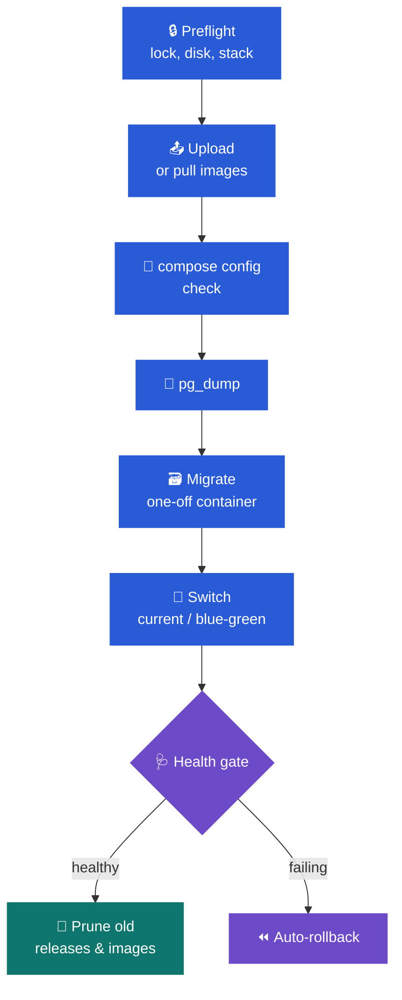

# 📘 deploy.me user guide

This guide walks through installing deploy.me, adding a server, importing a project, and
running it in production: deploys, rollbacks, blue/green, alerts and backups. Each
chapter stands on its own, so skip to the one you need.

- [1. Install](#1--install)
- [2. Sign in: passkey or password](#2--sign-in-passkey-or-password)
- [3. Add a server](#3--add-a-server)
- [4. Import a project](#4--import-a-project)
- [5. Tune the project's settings](#5--tune-the-projects-settings)
- [6. Assign it to a server and prepare the folder](#6--assign-it-to-a-server-and-prepare-the-folder)
- [7. Deploy](#7--deploy)
- [8. Roll back, redeploy, retry, cancel](#8--roll-back-redeploy-retry-cancel)
- [9. Env files](#9--env-files)
- [10. Projects that were already running](#10--projects-that-were-already-running)
- [11. Deploy on green CI](#11--deploy-on-green-ci)
- [12. Health checks, dashboard and alerts](#12--health-checks-dashboard-and-alerts)
- [13. Actions](#13--actions)
- [14. Folder mappings](#14--folder-mappings)
- [15. Audit log](#15--audit-log)
- [16. Back up deploy.me itself](#16--back-up-deployme-itself)
- [17. Update deploy.me](#17--update-deployme)
- [18. Let an AI agent help](#18--let-an-ai-agent-help)
- [19. The Console theme](#19--the-console-theme)
- [20. Troubleshooting](#20--troubleshooting)

---

## 1. 🧱 Install

You need **Docker** and your servers in **`~/.ssh/config`**. deploy.me runs the same way on
macOS, Linux and Windows (inside WSL2), and brings its own PostgreSQL, Valkey and HTTPS
edge, unless you already run a shared stack it can join.

```bash
curl -fsSL https://raw.githubusercontent.com/KielD-01/deploy.me/main/install.sh | bash
```

That clones deploy.me into `~/deploy.me` and runs `bin/install` there. On Windows, run this
in PowerShell instead:
`irm https://raw.githubusercontent.com/KielD-01/deploy.me/main/bin/install.ps1 | iex`.

`bin/install` works through these steps:

1. It checks the tools it needs.
2. `bin/configure` writes `.env` and `compose.host.yml` for this machine: the stack mode,
   the user the containers run as, your timezone, your project roots and your ssh-agent.
3. `bin/db-create.sh` creates `src/api/.env` and the `deployme` role and databases.
4. It builds the image, starts the stack and builds the assets.
5. `deployme:setup` generates `APP_KEY` and the Reverb credentials, and migrates.
6. `bin/trust-ca` trusts the edge's local CA in your browsers.
7. `make doctor` checks everything.
8. It prints the link that sets up your passkey or password.

Each OS has its own notes: Linux UIDs, WSL and your Windows `.ssh`, Firefox. Those, and the
two stack modes, are in **[install.md](install.md)**.

> [!WARNING]
> **Back up `APP_KEY`** from `src/api/.env` and keep it in a password manager. GitHub tokens
> and env files are encrypted with it, and they can't be read without it.

## 2. 🔑 Sign in: passkey or password

deploy.me has one account per machine. There are two ways to create it:

- **In a terminal.** `make setup` (part of `make init` and `bin/install`) prints a one-time
  link that works once, for 15 minutes; `make enroll` prints a new one whenever you need it.
- **In the browser.** With `DEPLOYME_WEB_SETUP=true` in `src/api/.env`, while there's no
  account, https://deployme.localhost offers **Create your account**: your name and email,
  then the link that signs you in. It's off by default, because until the account exists
  anything that can reach the web container could claim it before you do.

Once the account exists, the browser page is gone and nobody can create another.

Either way, you then choose how you'll sign in:

- **A passkey** (recommended): Touch ID, Windows Hello, iCloud Keychain, 1Password, a phone
  or a security key.
- **A password**, for a device that can't use passkeys: at least 12 characters, under
  Settings → Account → Password.

You can have both, and several passkeys. Under **Settings → Account**:

- **Authenticator codes** (optional) make password sign-in also ask for a 6-digit code
  from an app such as Google Authenticator, 1Password or Aegis. You get recovery codes for
  when the phone is lost. A passkey never needs a code.
- **The last way in can't be removed.** Removing the only passkey, or the only password,
  is refused until there's another way in.
- **Lost your way in?** `make enroll` again prints a new link that signs you in. There's no
  email reset.

Password sign-in allows five tries a minute, and so does the code prompt.

Sensitive actions ask you to confirm it's you again, with a passkey or the password.
These include trusting a host key, revealing or editing env files, deleting files during a
sync, removing a GitHub token, and changing how you sign in.

## 3. 💻 Add a server

**Servers → Add server** walks you through four steps:

1. **Pick a host.** The list comes from your `~/.ssh/config`. deploy.me shows what `ssh -G`
   resolves for the host (HostName, User, IdentityFile, ProxyJump), so you can see exactly
   where it will connect.
2. **Connection check.** It connects and shows the server's host key fingerprint. Compare
   it with the one on the server, then click **Trust and continue**. The key is pinned from
   then on, and a changed key stops every connection.
3. **Default deploy path.** Choose where projects go, for example `/opt`. You'll see the
   filesystem and free space. A project lands in `{path}/{project-slug}`.
4. **Name and environment.** Name the server, tag it (production, staging, development),
   and review what deploy.me found: Docker, Compose, git, rsync, the edge proxy, passwordless
   sudo.

The server is then probed on a schedule: CPU, load, memory, disks, Compose stacks, and the
ten busiest processes by CPU, memory and TCP traffic. Its page has five tabs: **Overview**,
**Stacks**, **Checks** (health check history), **Folders** and **Settings**.

> [!TIP]
> `make sandbox` starts a local SSH server with Docker under the alias `sandbox`. It's a
> safe place to try everything before you point deploy.me at a real machine.

### Reach a server through a VPN, a proxy or a jump host

A server you can't reach directly gets a **connection route** on its **Settings** tab. Every
probe, deploy, folder sync, upload and health check to it goes that way, because the route
is written into the ssh config deploy.me compiles (ahead of your `~/.ssh/config`, so it wins
over a ProxyJump there), and ssh, rsync and git all read that config.

| Route | What it does | What your machine needs |
|---|---|---|
| **Direct** | As your `~/.ssh/config` says, ProxyJump included | Nothing |
| **Jump host** | `ProxyJump` through another host: an alias from `~/.ssh/config`, or `user@host:port` | The jump host's key, like any server |
| **SOCKS5 proxy** | ssh connects through the proxy, with a user and password if it wants one | A proxy the containers can reach: `ssh -D`, `tailscaled --tun=userspace-networking --socks5-server=…`, an office proxy. One on this machine is `host.docker.internal` |
| **HTTP proxy** | The same through `CONNECT` (it must allow the ssh port) | As above |
| **VPN on this machine** | Nothing changes in ssh: the VPN routes the traffic. deploy.me checks it, it never starts it | WireGuard or Tailscale running on the host. Docker Desktop and OrbStack usually send the containers' traffic through the Mac's VPN, and on Linux Docker's NAT does the same (if yours doesn't, Tailscale's userspace SOCKS5 proxy works as a proxy route). Use the server's VPN IP in `HostName` (MagicDNS names don't resolve inside containers), and give a **check address** only the VPN reaches, like its gateway |

Saving a changed route asks for your passkey first. The proxy password is stored encrypted
and never shown again. It reaches the proxy through
a small helper that ssh runs as its `ProxyCommand`, which reads it from a private file in
deploy.me's memory-only runtime folder: never from a command line or a log.

**Check route** (the server's header, or <kbd>n</kbd> in the Console theme) asks the VPN's
check address, the proxy or the jump host, then the server's ssh port through it, and
reads its ssh banner. Nothing is signed in to or run on the server. The same check runs
before every probe and as the first thing a deploy's pre-flight step does:

- **route down**: the VPN, proxy or jump host didn't answer or let deploy.me in. The probe
  marks the server offline with the reason and tries again within a minute; a deploy stops
  at pre-flight and changes nothing; scheduled health checks wait.
- **server unreachable**: the way in works, but the server didn't answer through it.

Each check is kept on the **Checks** tab beside the health checks (for as long as they
are), and `make doctor` checks every route too.

## 4. 📦 Import a project

**Projects → Import project** reads a project without cloning it:

- **From GitHub.** Add a token under **Settings → GitHub** first. It's stored encrypted.
  Then pick a repository; deploy.me reads it through the API.
- **From local folder.** Pick a folder inside your project roots. deploy.me reads its git
  state, and can create the GitHub repository and push the code for you if it doesn't
  have one yet.

Detection finds:

- **GitHub workflows**, including ones that build images on GHCR and jobs that already
  deploy over SSH;
- **Compose files**, with the stack name, app services, image pins, each service's command
  and stop grace period;
- **the framework**, up to three folders deep;
- **env templates**.

From what it found, it suggests the deploy settings.

## 5. 🔧 Tune the project's settings

The project's **Settings** tab applies to every server the project deploys to.

| Setting | What it means |
|---|---|
| **Versionable** | Each deploy goes into `releases/<timestamp>/`, with `shared/` for files that persist and an atomic `current` symlink. Off means **in place**: files are synced into the folder itself, and Docker images are pinned per release so a rollback still works |
| **Shared folders** | Paths that live in `shared/` and are linked into every release (`storage`, uploads, …) |
| **Dockerized** | Stack name, Compose files, the service that migrates, and the app services recreated on each deploy |
| **Back up before migrating** | `pg_dump` as `DB_USERNAME` from the env file, or a role you name (`postgres`). Set how many dumps to keep in `.deploy/backups` |
| **Delivery, in order** | Drag to reorder. The first strategy that applies wins: **GHCR image** (CI's images for the commit), **push archive** (a git archive uploaded with rsync), **push rsync** (the folder as it is), **server git** (the server fetches the commit itself) |
| **Wait for CI** | When the first strategy is waiting for CI, the run waits too, re-checking every 20 s for up to an hour. **Deploy now** skips ahead |
| **Image pins** | Which images and tags a commit's CI publishes (`{owner}`, `{repo}`, `{sha}`, `{sha7}`). **Back to detection** resets them |
| **Health and rollback** | An HTTP check (200 within the timeout), a command run on the server, and **roll back automatically** when either fails |
| **Activation** | deploy.me's own steps, or the project's deploy script (it gets `IMAGE_TAG=…` and a registry login) |
| **Blue/green** | Edge-facing services with a health check start *beside* the old ones. The old ones are removed only once the new colour is healthy, so a failed deploy costs no downtime |

The **Hooks** tab runs your commands at three points in a deploy: after the upload, at
release time (before the switch), and after activation. Each runs either on the host in
the release folder, or in a one-off or running container of a Compose service.

## 6. 🎯 Assign it to a server and prepare the folder

On the project's **Targets** tab, click **Assign to server**. Pick a server, then where the
project goes on it:

- **Inside a folder**: `{folder}/{slug}`. The folder starts as the server's default deploy
  path, and you can pick another.
- **Exact folder**: the project lives in exactly this folder, whatever its name
  (`/srv/www/shop-stage`).

The folder is set per server, not per project, because folders are a fact of each server:
the same project often lives in `/opt/srv/shop` on one and `/srv/www/shop` on another. It
must be absolute and at least two folders deep, outside the shared infrastructure's
folder (`/opt/infra`), the system's folders (`/etc`, `/usr`, `/var/lib`, …) and a home
folder itself, and neither inside nor around another project's folder on that server.
Changing the server's default deploy path later doesn't move existing targets.

Then click **Prepare**. It creates `releases/` and `shared/` and uploads the env files,
keeping anything an earlier deployment left in the folder.

**Change folder…** (the target's ⋯ menu) points a target somewhere else while nothing
deploy.me deployed runs from it: only the record changes, the next deploy or Prepare
builds the layout in the new folder, and whatever Prepare made in the old one stays on the
server. A **live** target isn't moved: its `releases/`, `shared/` and the running stack are
in the old folder, and moving them under a running stack would leave its containers
pointing at the old paths. To move one, remove the target (nothing on the server changes),
assign the project again with the new folder, copy `shared/` across on the server, deploy,
and delete the old folder by hand once it's healthy.

## 7. 🚀 Deploy

Click **Deploy** on the project page. The dialog shows:

- **Where:** one target or all of them.
- **What:** the branch's recent commits, with CI status, which ones add migrations, and
  where each one is already live.
- **How:** the delivery strategy that will ship it, and why each strategy above it doesn't
  apply.
- **Migrations:** for Docker projects that migrate, back up first or skip the migrations.

The run page streams a live, redacted log, step by step. A Docker deploy goes like this:



Only one run per target can happen at a time. A double click lands on the same run.

## 8. ⏪ Roll back, redeploy, retry, cancel

- **Roll back.** On the **Releases** tab, pick an earlier release. For versionable projects,
  `current` switches back. For in-place Docker projects, the release's pinned images are
  restored and the stack comes up on them. Only releases that can actually come back are
  offered.
- **Redeploy.** Deploy a release's commit again, for example after changing env files.
- **Retry.** A failed run can retry from the step that failed, reusing its release.
- **Cancel.** A queued run stops at once. A running one stops at its next check, and its
  cleanup still runs: it switches back and unlocks. Whatever it left running on the server
  is stopped.
- **Break lock.** If a lock was left behind by a run that is gone, **Break lock** removes it.
  This is written to the audit log.

## 9. 🔐 Env files

The **Environment** tab keeps each env file encrypted and versioned. Revealing, editing or
importing one needs a passkey. Every deploy writes the current version to `shared/`.

Was the project deployed before deploy.me? Then **Import from server** reads the env files
the compose file names, plus `.env`, from `shared/`, `current/` or the folder itself. They
come in as a new version. Until deploy.me has them, it can't tell which database to back up
before migrating.

> [!CAUTION]
> Once deploy.me has a project's env files, it writes them on **every** deploy. Make edits
> in deploy.me, not on the server, or they'll be overwritten.

## 10. 🧳 Projects that were already running

- **Adopt.** A project deployed in place by hand or by CI can be adopted: from the Targets
  menu, or from the **Adopt** button on a server's **Stacks** tab. deploy.me records the
  running commit, the image tags its `.env` pins, and the stack as the live release, so
  there's something to roll back to.
- **Convert to releases.** A versionable project whose folder still holds an older in-place
  deployment is converted before its first deploy. deploy.me reads the folder (read-only),
  finds the commit the files came from, and plans what goes into the first release, what
  goes into `shared/`, and what stays. Every move is logged, a run that stops halfway puts
  everything back, and **Undo conversion** works while the converted release is live. The
  backup is kept until you remove it, which needs a passkey.

## 11. 🟢 Deploy on green CI

deploy.me polls GitHub Actions for each project. With **auto-deploy** on, it deploys by
itself when CI passes on the branch's head. It never goes backwards: a target already at or
past the head is left alone, because going back is a rollback, and only a person starts one.

The projects list and the dashboard point out a green build that no server runs yet.

## 12. 🩺 Health checks, dashboard and alerts

- Each deployed target with a health URL or a Docker stack is checked on a schedule. The
  check asks the server's own edge first, so a CDN challenge can't fail it. The server's
  **Checks** tab keeps the history.
- The **dashboard** compares each target's live commit with its branch head.
- **Settings → Alerts.** Enter a Telegram bot token and chat id, then send a test message.
  You'll get a message when a run fails, rolls back or stalls, and when a site stops or
  starts answering. A failure to send never fails the run.
- **Settings → Schedules** sets probe and health intervals, and how long logs, snapshots
  and checks are kept.

## 13. ▶️ Actions

An action is a named job you run on a target when you need it: clear the caches, reindex
search, restart the workers, take a database snapshot. It can also run on a schedule, or
after a deploy. Each run is a run like a deploy: it takes the folder's deploy lock (so it
never runs beside a deploy, and is refused while one runs), streams a live log with
secrets masked, can be cancelled, and is kept in the history with who started it.

Actions come from two places, shown together on the project's **Actions** tab:

- **The repository.** YAML files in `.deployme/actions/` (`.yml` or `.yaml`), read at the
  head of the project's branch when it's imported, when detection is refreshed, and on
  **Reload from repo**. The file's name is the action's key. They're read-only on the page:
  you change them in git. A file that doesn't pass the checks is listed with its errors and
  can't run until it does.
- **Made here.** **+ New action** opens the editor (it asks for your passkey first, since
  an action runs commands on your servers). **Copy as YAML** turns one into a file for the
  repository.

```yaml
# .deployme/actions/reindex-search.yml
name: Reindex search
on:
  manual: true                # the Run button, the shell, MCP (the default)
  schedule: "30 4 * * 0"      # cron, in the machine's timezone (TZ)
  target: edge-fra            # the server a schedule runs on
  # after_deploy: succeeded   # or failed, or either
inputs:
  index: { type: choice, options: [products, orders, all], default: products }
  fresh: { type: boolean, default: false, description: Flush the index first }
  # also text, number and secret (masked in logs, never stored, no default)
steps:
  - name: Flush the index
    if: inputs.fresh          # skipped (and shown as skipped) while it's off
    exec: api                 # in the running api container
    run: php artisan scout:flush "$INDEX"
  - name: Import
    one-off: worker           # in a one-off container, with the edge's labels reset
    run: php artisan scout:import "$INDEX"
    timeout: 15m              # 10m when left out; at most 1h
  - name: Warm the cache
    run: curl -fsS https://example.com/ -o /dev/null   # on the server
    continue-on-error: true   # recorded as failed, and the run goes on
# targets: [edge-fra]         # the servers it may run on (all of them when left out)
# confirm: passkey            # ask for your passkey first: then only you can start it
# mcp: true                   # let an agent start it with run_action
# alert: false                # no Telegram message when it fails
```

- **Where steps run.** In the live release's folder (`releases/<name>` for projects with
  releases, the project folder for in-place ones): on the server, in a service with
  `exec:`, or in a one-off container with `one-off:`. A target with nothing live yet can't
  run actions.
- **Inputs** reach every step as UPPER_CASE environment variables (`keep-days` becomes
  `KEEP_DAYS`; a yes/no is `1` or `0`), sent over stdin with the script, never on a command
  line. A step with `env-file: true` also gets the variables of the project's env file.
- **Running one.** **Run** opens a dialog: the target, the inputs, and what will run where.
  The run page shows the inputs (secrets as `••••••`), who or what started it, and
  **Run again**.
- **On a schedule** it starts when the cron comes due; if the target is busy it tries again
  each minute for up to an hour. **After a deploy** it starts once the deploy's run has
  ended (succeeded, failed or either); several go one after the other. An action that fails
  never rolls a deploy back.
- **Safety.** An action that asks for a passkey runs only when you start it, never on a
  schedule, after a deploy or from an agent. Agents can only start actions marked `mcp: true`.
  Creating, changing and removing an action, and every run, go into the audit log (never
  an input's value).

## 14. 🔁 Folder mappings

On a server's **Folders** tab, map a folder on your machine to a folder on the server and sync
it one way, push or pull, with rsync.

- **Preview** is a dry run and changes nothing.
- Deleting files that aren't in the source is off by default and needs a passkey. A run
  that deletes starts from a preview and can't delete more than the preview counted.
- Scheduled syncs (hourly or daily) delete at most a capped number of files.
- Nothing is ever pushed into a reserved path such as `/opt/infra`.

## 15. 📜 Audit log

**Audit** lists who trusted a host key, broke a lock, saved or removed a token, or removed a
server, project or target, along with every command deploy.me ran on a server. It never
stores a value. The table is append-only: the database refuses updates, and only the
nightly prune may delete.

## 16. 💾 Back up deploy.me itself

```bash
make backup-install   # nightly at 03:20 (launchd · systemd timer · cron)
make backup           # now
make backup-status    # when it last ran, what's kept
```

This writes a `pg_dump` of the `deployme` database and a copy of `src/api/.env` (with
`APP_KEY`) into `~/Backups/deployme`, keeping the last 14. The dumps (never the key) are
also copied to iCloud Drive on a Mac that has it, or to `DEPLOYME_OFFSITE_DIR` if you set it. Everything else can be rebuilt from git and
the servers.

## 17. ⬆️ Update deploy.me

deploy.me looks once a day for a newer release of itself (one anonymous request to the
repository's GitHub releases; nothing about your machine is sent). When one is out you see
it three places: **Settings → Updates** (with the release notes), the Console theme's status
bar (`↑ 1.0.2`) and its `status` command, and the account menu in the Classic theme.

Applying it is done **on the machine deploy.me runs on**, because an update rebuilds and
restarts the very containers the app runs in:

```bash
bin/update            # the newest release (make update)
bin/update check      # is there one? (make update-check)
bin/update v1.2.0     # that release
bin/update status     # what runs, what's out, the nightly job, the last run
bin/update --dry-run  # say what it would do
```

What `bin/update` does, stopping at the first thing that doesn't hold:

1. Checks that your checkout has no changes of its own and that **no deploy or folder sync is
   running** (the stack restarts, so it waits).
2. Runs `bin/backup.sh`: the database and the `APP_KEY` (see chapter 15). No backup, no update
   (`--no-backup` if you know why).
3. Moves the checkout to the release tag: a fast-forward of your branch, so a branch with
   commits of its own stops here and nothing changes.
4. Rebuilds the image (`bin/build`), the assets in development mode, and restarts the web,
   worker and Reverb containers. The web container applies pending migrations as it starts.
5. Waits for the web container to turn healthy and runs `bin/doctor.sh`. **If that fails it
   goes back** to the previous commit and rebuilds. Migrations the new code ran are not
   undone (they add before they remove); the backup from step 2 is there, and its path is in
   the message.

The result of the last run is shown in Settings → Updates and, with Telegram alerts set up
(chapter 12), sent there.

### Let it update by itself

Off by default. To turn it on:

```bash
bin/update auto patch   # patch releases (1.0.x) every night at 04:10
bin/update auto all     # every release
bin/update auto off     # back to doing it yourself
```

This installs the nightly job (a LaunchAgent on macOS, a systemd user timer or cron on
Linux and WSL2) and keeps the choice in Settings → Updates, where you can also change it
(turning it on asks for your passkey, since it restarts the stack unattended). At night it
applies only what the choice allows, **never while a deploy or a folder sync is running**
(it tries again the next night), and writes to `~/Backups/deployme/update.log`. A minor
release (1.**1**.0) can bring migrations, which is why "patch" is the middle setting.

If your checkout's tags come from a remote other than `origin`, set `DEPLOYME_UPDATE_REMOTE`.
A fork that publishes its own releases sets `DEPLOYME_UPDATE_REPO=owner/name` in `.env`
of the app (`src/api/.env`).

## 18. 🤖 Let an AI agent help

```bash
claude mcp add deployme -- docker exec -i deployme-web php artisan deployme:mcp
```

Now ask *"what's deployed where?"* or *"why did run #42 fail?"*. Add `--allow-deploys` to
let the agent deploy and roll back. See **[docs/mcp.md](mcp.md)** for every client and
every tool.

## 19. 🖥️ The Console theme

The Console is the default look: deploy.me as a **tmux session**. Switch between it and
the **Classic** pages (a top bar, cards and tables) under **Settings → Appearance**, or
from the shell with `theme classic` and `theme console`. Everything below also works with
the mouse; the keys are shortcuts, never the only way.

**The session.** The first window, `0:ops` (the dashboard), is a set of panes you split.
Each pane is one of:

| Pane | Shows |
|---|---|
| `shell` | A prompt for deploy.me's own commands (below) |
| `status` | Every target: live commit, health, last run |
| `tail` | A run's steps and live log (the newest run, or the one you open) |
| `htop` | A server's load, memory and busiest processes |
| `git` | A project's branch, with where each commit is live |

The default layout (`ops`) puts the shell on the left, and `tail`, `htop` and `git` on the
right. Two more are saved: `deploy` (shell beside a run's log) and `watch` (status on top,
log and shell below). The layout is kept on your account as you change it, so it's the
same in every browser. Drag a border to resize, click a pane to focus it. A command that
starts a run (`deploy`, `rollback`) opens its log in a pane for you.

**Windows.** The status bar at the bottom lists the other pages as windows: `0:ops`,
`1:runs`, `2:servers`, `3:projects`, `4:audit`, `5:settings`. A page opens as one pane,
and `⌃b 0` brings you back to the session. Failing and running counts, and whether live
updates are connected, sit on the right of the bar.

**Keys.** The prefix is `⌃b` (Control and b, as in tmux): press it, let go, then press
the next key within a second and a half. `⌃b ?` lists them all.

| Keys | Does |
|---|---|
| `⌃b %` | Split the active pane right |
| `⌃b "` | Split the active pane down |
| `⌃b o` | Move to the next pane |
| `⌃b z` | Zoom the active pane, or put it back |
| `⌃b x` | Close the active pane |
| `⌃b L` | Load the next saved layout (`ops`, `deploy`, `watch`) |
| `⌃b /` | Focus the shell |
| `⌃b 0`–`5` | Go to a window |
| `⌃b n`, `⌃b p` | Next and previous window |
| `⌃b w` | Choose a window from a tree |
| `F1`–`F6` | Go to a window without the prefix (on a Mac keyboard this may need `fn`) |
| `Esc` | Close the key list or the tree |

Pages also have one-letter keys of their own, shown beside the buttons they press. They
never fire while you are typing, or right after the `⌃b` prefix.

**The shell.** `Tab` completes commands and names (projects, servers, runs), `↑` and `↓`
walk the history, and `⌃c` drops a question you were asked. Anything that changes a
server shows what it will do, then asks first. Leave out an argument and the shell asks
you to pick one. The runs it starts are recorded with the trigger `console`.

| Command | What it does |
|---|---|
| `help` | The list of commands, and the pane keys |
| `status` | Every target: live commit, health, last run |
| `runs` | Recent runs; `runs <project>` for one project |
| `servers` | Servers, their status and load |
| `projects` | Projects, their branch and CI |
| `deploy` | `deploy <project> <server> [--commit <sha>] [--no-backup] [--skip-migrations]`: picks a commit, shows the plan, asks, then starts the run |
| `rollback` | `rollback <project> [<server>] [<release>]`: picks an earlier release, asks, then starts the rollback |
| `cancel` | `cancel <run>`: cancels a queued or running run, after asking |
| `actions` | `actions <project>`: its actions, when each runs and its last run; `--history` lists their runs |
| `run` | `run <action> --on <server> [name=value…]`: asks for each input it isn't given (secrets at the prompt, never on the line), shows the plan, asks, then starts it. `--yes` takes the defaults for the inputs left out; it still asks before it runs. `project/action` when two projects have one by that name |
| `probe` | `probe <server>`: queues a fresh probe |
| `open` | `open tail <run>`, `open htop <server>`, `open git <project>` or `open status`: shows it in a pane |
| `go` | Go to a page: `go runs`, `servers`, `projects`, `audit`, `settings`, `run <n>`, `server <name>` or `project <name>` |
| `theme` | `theme console` or `theme classic` |
| `clear` | Clear the screen |

## 20. 🧯 Troubleshooting

Start with:

```bash
make doctor
```

It checks infra, containers, TLS, websockets, the queues, the scheduler, the host mounts,
every server alias (`ssh -G`, key file permissions, host key, and its route when it has
one) and the GitHub tokens.

| Symptom | Where to look |
|---|---|
| The page doesn't load | `make ps`. Is the edge running (`deployme-caddy`, or the shared `caddy`)? Is the local CA trusted (`bin/trust-ca`)? |
| Live logs don't update | `make logs s=deployme-reverb`. `make doctor` checks websockets through the edge |
| A run sits in **Queued** | `make workers`. The `redis-deploys` worker runs deploys |
| A run shows **Stalled** | The worker stopped reporting. Check `make logs s=deployme-worker`, then retry |
| "Another Compose project already runs from this folder" | Preflight refuses to start a second stack beside it. Adopt or convert the folder first |
| "The route to … is down" | The server's **Checks** tab says which hop failed. Is the VPN connected on this machine? Is the proxy up, and does it take the user and password? A proxy on the host is `host.docker.internal` from the containers |
| "… doesn't answer through its route" | The VPN, proxy or jump host works but can't reach the server's ssh port: the server's address, its firewall, or the proxy's rules |
| Host key changed | Expected after rebuilding a server. Check it out of band, then trust the new key on the server's page |
| `pg_dump` refused by row security | Back up as a role RLS doesn't apply to (`postgres`) in the project's settings |

| Command | |
|---|---|
| `make logs s=deployme-worker` | Queue workers and the scheduler |
| `make artisan c="deployme:doctor"` | The app-side checks only |
| `make sh` | A shell in the web container |
| `make help` | Every target |
